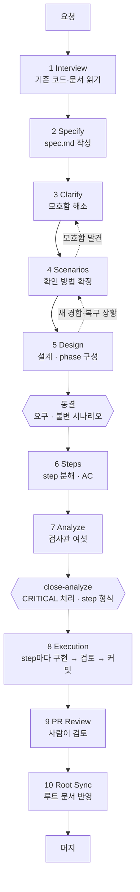
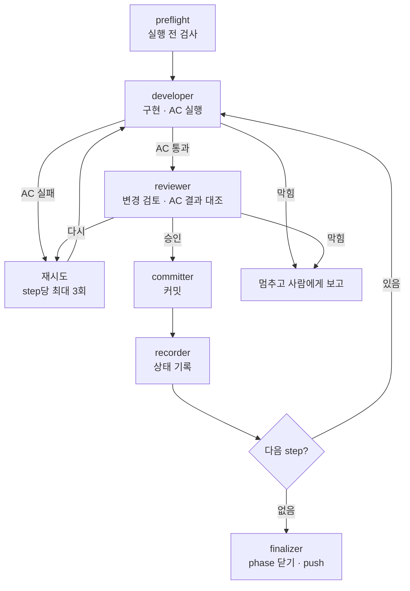
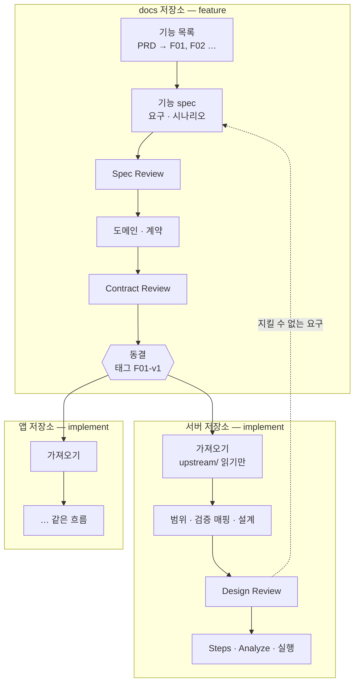

# spec-harness

명세를 먼저 확정하고, 확정된 명세대로 구현하게 하는 Claude Code 플러그인.

- 틀리면 데이터·돈·권한이 깨지는 곳은 추측으로 채우지 않고 사용자에게 묻는다.
- 통과 기준은 실행 명령이다. step마다 Acceptance Criteria 명령을 돌려 exit code로 판정한다.
- 구현한 에이전트와 검토하는 에이전트가 다르다.

---

## 어떤 skill을 쓰나

| 상황 | skill |
| --- | --- |
| 한 저장소에서 명세부터 구현까지 | [`/spec-harness:run`](skills/run/SKILL.md) |
| 여러 저장소(서버·앱)가 한 제품을 만든다: docs 저장소에서 기능 spec 확정·동결 | [`/spec-harness:feature`](skills/feature/SKILL.md) |
| 위의 구현 저장소에서 동결된 기능 spec을 가져와 구현 | [`/spec-harness:implement`](skills/implement/SKILL.md) |
| 끝난 작업의 실행 기록에서 반복되는 실패 찾기 | [`/spec-harness:retro`](skills/retro/SKILL.md) |
| 흐름과 내가 개입할 지점 안내 | [`/spec-harness:guide`](skills/guide/SKILL.md) |

---

## run — 한 저장소에서



| 묶음 | 단계 | 하는 일 |
| --- | --- | --- |
| 명세 | [1 Interview](skills/run/references/stages/interview.md) | 기존 코드·문서를 읽고 요청을 파악한다 |
| | [2 Specify](skills/run/references/stages/specify.md) | 작업 공간을 만들고 `spec.md`에 요구와 완료 기준을 쓴다 |
| | [3 Clarify](skills/run/references/stages/clarify.md) | 모호한 곳을 사용자와 확정한다 |
| | [4 Scenarios](skills/run/references/stages/scenarios.md) | 요구마다 어떻게 확인할지 정한다 |
| | [5 Design](skills/run/references/stages/design.md) | 설계 문서와 phase를 정한다. 여기서 요구와 불변 시나리오가 동결된다 |
| 변환·검증 | [6 Steps](skills/run/references/stages/steps.md) | step으로 나누고 step마다 AC를 쓴다 |
| | [7 Analyze](skills/run/references/stages/analyze.md) | 검사관 여섯이 문서를 나눠 검사한다 |
| 실행 | [8 Execution](skills/run/references/stages/execution.md) | 실행 워크플로가 step마다 구현 → AC → 검토 → 커밋을 돈다 |
| | [9 PR Review](skills/run/references/stages/pr-review.md) | 사람이 PR을 검토한다 |
| | [10 Root Sync](skills/run/references/stages/root-sync.md) | 루트 문서에 반영하고 spec 폴더를 `_archive/`로 옮긴다 |

명세 묶음은 며칠에 걸쳐 진행해도 된다. 진행 상태는 spec 폴더의 `workflow-checklist.json`에 남고, 다음 세션은 끝나지 않은 단계부터 이어 간다.

주요 게이트는 스크립트가 막는다. 처리하지 않은 CRITICAL이 있거나 검사한 뒤 문서가 바뀌었으면 실행이 시작되지 않는다. 단계별 조건은 [게이트 표](skills/run/SKILL.md)에 있다.

### Analyze — 검사관 여섯

| 검사관 | 보는 것 |
| --- | --- |
| [traceability](agents/analyzer-traceability.md) | 요구 → 시나리오 → step → AC 연결이 끊긴 곳 |
| [domain](agents/analyzer-domain.md) | 엔티티 · 상태 전이 · 불변식 |
| [concurrency](agents/analyzer-concurrency.md) | 동시 요청 결과 · 멱등 · 실패 뒤 되돌림 |
| [access](agents/analyzer-access.md) | 누가 부를 수 있나 · 남의 데이터가 보이나 |
| [rules](agents/analyzer-rules.md) | `CLAUDE.md`와 저장소 규칙 위반 |
| [clarity](agents/analyzer-clarity.md) | 측정 기준 없는 요구 · 용어 불일치 |

발견마다 실패 시나리오를 붙인다. CRITICAL은 고친 뒤 다시 검사해 사라지거나, 근거를 남기고 반려해야 넘어간다. 공통 규칙은 [analysis-contract.md](skills/run/references/analysis-contract.md)에 있다.

### Execution — step 하나가 도는 방식



멈춘 step은 사람이 원인을 고치고 `reset-step`으로 되돌려야 다시 돈다. 같은 실패를 반복하지 않기 위해서다.

---

## 저장소를 나눌 때 — feature · implement



요구·시나리오·계약은 docs 저장소에서 한 번 정하고, 각 구현 저장소는 그 버전을 읽기만 한다. 구현하다 기능 spec을 바꿔야 하면 docs 저장소에 변경을 요청해 버전을 올리고 다시 가져온다. 동작이나 계약이 바뀌지 않는 내부 작업(리팩터, 성능, 로깅)은 구현 저장소에서 `run`으로 한다.

| feature 단계 | 문서 |
| --- | --- |
| 0 기능 목록 | [feature SKILL](skills/feature/SKILL.md#0-기능-목록) |
| 1 Interview · 2 Specify · 3 Clarify · 4 Scenarios | run의 같은 단계. 다른 점은 [feature SKILL](skills/feature/SKILL.md#1-interview) |
| 5 Spec Review | [review.md](skills/feature/references/review.md) |
| 6 Domain | [feature SKILL](skills/feature/SKILL.md#6-domain) |
| 7 Contract | [contract.md](skills/feature/references/contract.md) |
| 8 Contract Review | [review.md](skills/feature/references/review.md) |
| 9 Freeze | [freeze.md](skills/feature/references/freeze.md) |
| 기능 변경 (버그 · 동작 변경) | [change.md](skills/feature/references/change.md) |

| implement 단계 | 문서 |
| --- | --- |
| 1 Import | [implement SKILL](skills/implement/SKILL.md#1-import) |
| 2 Scope | [implement SKILL](skills/implement/SKILL.md#2-scope) |
| 3 Clarify | run의 같은 단계. 다른 점은 [implement SKILL](skills/implement/SKILL.md#3-clarify) |
| 4 Verification | [verification.md](skills/implement/references/verification.md) |
| 5 Design | run의 같은 단계. 다른 점은 [implement SKILL](skills/implement/SKILL.md#5-design) |
| 6 Design Review | [design-review.md](skills/implement/references/design-review.md) |
| 7 Steps | run의 같은 단계. 다른 점은 [implement SKILL](skills/implement/SKILL.md#7-steps) |
| 8 Analyze | run의 같은 단계. 검사 범위는 [design-review.md](skills/implement/references/design-review.md#analyze에-더하는-것) |
| 9 Execution · 10 PR Review · 11 Root Sync | run의 같은 단계. 다른 점은 [implement SKILL](skills/implement/SKILL.md#911-execution--pr-review--root-sync) |

---

## 설치

나만 쓸 때:

```
/plugin marketplace add KimYeonWook511/spec-harness-plugin
/plugin install spec-harness@KimYeonWook511-harness
/reload-plugins
```

팀이 같이 쓸 때는 저장소의 `.claude/settings.json`에 등록한다.

```bash
claude plugin marketplace add KimYeonWook511/spec-harness-plugin --scope project   # 터미널에서
```

```
/plugin install spec-harness@KimYeonWook511-harness   # 세션에서, project scope 선택
/reload-plugins
```

`.claude/settings.json`에 아래 두 키가 모두 있으면 된다. 설치 과정에서 `extraKnownMarketplaces`가 지워지는 경우가 있으니 커밋 전에 확인한다.

```json
{
  "extraKnownMarketplaces": {
    "KimYeonWook511-harness": {
      "source": { "source": "github", "repo": "KimYeonWook511/spec-harness-plugin" }
    }
  },
  "enabledPlugins": { "spec-harness@KimYeonWook511-harness": true }
}
```

새 버전은 `/plugin marketplace update KimYeonWook511-harness`로 받는다.

---

## 저장소 설정

### `.spec-harness/config.json` — 팀이 공유

설정이 없어도 동작한다. 이때 규칙 문서는 `CLAUDE.md`만 읽는다. 바꾸고 싶은 것만 `.spec-harness/config.json`에 적고 커밋한다.

```json
{
  "rule_docs": ["docs/coding-rules.md"],
  "commit_rule_docs": ["docs/commit-rules.md"],
  "methodologies": ["bdd"],
  "workspace": { "base_ref": "develop", "branch_pattern": "<type>/<name>" }
}
```

| 키 | 뜻 |
| --- | --- |
| `rule_docs` | `CLAUDE.md` 말고 규칙으로 읽을 문서. `{"path": ..., "section": "## 핵심 원칙"}`이면 그 절만 읽는다 |
| `commit_rule_docs` | 커밋 메시지 규칙 문서 |
| `reference_docs` | step 문서가 언급할 때만 함께 읽는 참고 문서 |
| `template_dir` | spec 문서 템플릿을 저장소 것으로 쓸 때 (기본은 플러그인 내장) |
| `run_root` | run이 spec 폴더를 만드는 곳 (기본 `docs/spec-harness/specs`) |
| `implement_root` | implement가 구현 폴더를 만드는 곳 (기본 `docs/spec-harness/implementations`) |
| `feature_root` | docs 저장소의 기능 spec 폴더 위치 (기본 `features`) |
| `upstream` | implement용. `on_newer_compatible`은 docs 저장소에 minor 새 버전이 있을 때 `warn`(기본) 또는 `block` |
| `methodologies` | 켤 방법론. `ddd`(도메인 규칙을 어디 둘지), `bdd`(시나리오를 검증 단위로) |
| `workspace` | `mode`(`worktree` 기본 · `branch`), `base_ref`(기본은 저장소 기본 브랜치), `branch_pattern`·`worktree_pattern`(`<type>`·`<name>` 치환), `types`(허용할 작업 종류) |
| `merge.agent` | Root Sync 전에 에이전트가 머지하려 할 때: `ask`(기본) · `root_sync`(막음) · `deny`(모든 머지 막음) |

### `.spec-harness/local.json` — 머신마다 다름, 커밋하지 않음

docs 저장소의 로컬 경로처럼 머신마다 다른 값을 둔다. worktree에서 실행해도 메인 체크아웃의 것 하나를 읽는다.

```json
{ "docs_repo": "/Users/me/work/product-docs" }
```

| 키 | 뜻 |
| --- | --- |
| `docs_repo` | implement가 기능 spec을 가져오는 docs 저장소의 절대경로. `execute.py set-docs-repo <경로>`로 기록한다 |

### `.gitignore`

진행 상태·실행 부산물·로컬 설정만 넣는다. spec 문서는 PR에서 보이도록 커밋한다.

```gitignore
/.spec-harness/run/
/.spec-harness/local.json
docs/spec-harness/**/workflow-checklist.json
docs/spec-harness/**/phases/index.json
docs/spec-harness/**/phases/*/index.json
docs/spec-harness/**/phases/*/step*-ac-output.json
docs/spec-harness/**/phases/*/logs/
```

docs 저장소는 `/.spec-harness/run/`과 `features/*/workflow-checklist.json`만 넣는다.

---

## 구성

| 경로 | 내용 |
| --- | --- |
| `skills/` | run · feature · implement · retro · guide |
| `workflows/execute.js` | 실행 워크플로 |
| `agents/` | 검사관 6 (`analyzer-*`), 실행 에이전트 5 (`developer` · `reviewer` · `committer` · `recorder` · `finalizer`), `domain-expert` |
| `methodologies/` | 켜서 쓰는 방법론 (`ddd`, `bdd`) |
| `hooks/` | 실행 로그 기록, Root Sync 전 머지 확인 |
