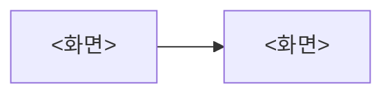

# 화면: <spec-name>

## 화면 흐름

## 화면별 상태

| 화면 | 상태 | 보이는 것 | 들어오는 조건 | 관련 시나리오 |
| --- | --- | --- | --- | --- |

## 계약 오류 → 화면 반응

> `upstream/contract.md`의 모든 오류 코드가 여기 있어야 한다. 계약의 "앱이 할 일"과 다르게 반응하지 않는다.

| 오류 코드 | 화면 반응 |
| --- | --- |
